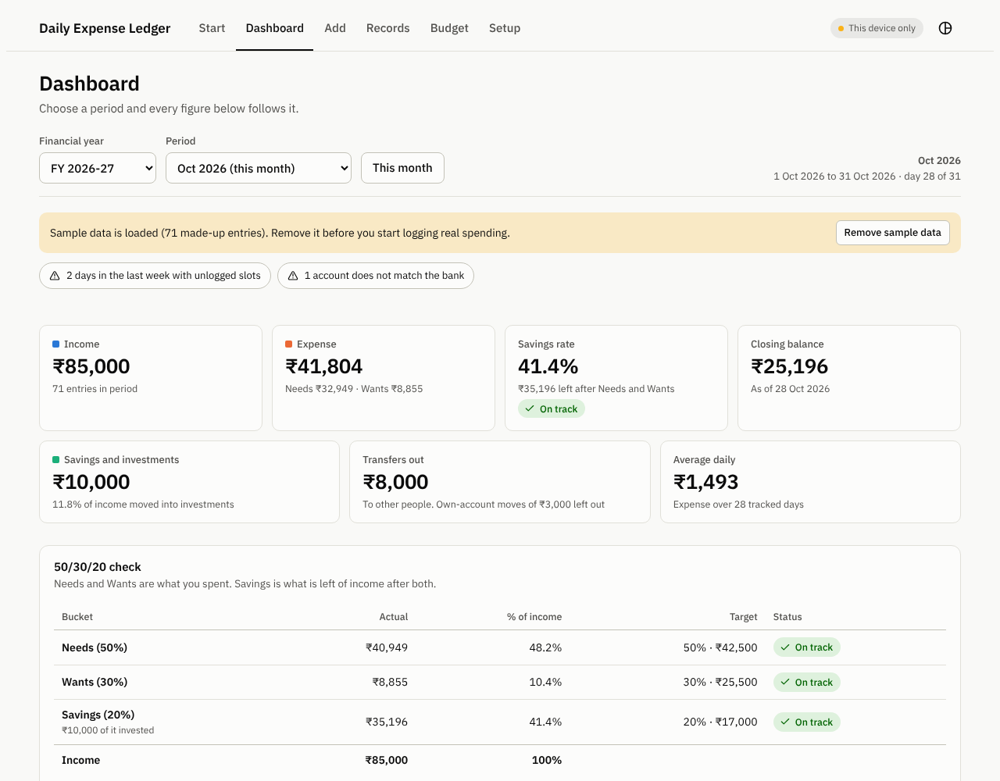

# Expense ledger

A personal daily, monthly and yearly expense ledger that runs in the browser. Log what you spend in four slots a day, reconcile against your bank balances, and read the month or the financial year at a glance. Works on laptops and phones, and keeps your data on your own devices.

**Live app:** https://sathyanarayanan-2001.github.io/expense-ledger/



## Features

- **Four slots a day:** Morning, Afternoon, Evening and Night. Log in any order, on any day, and mark a slot *No spend* so a gap always means forgotten, never zero.
- **Catch up:** the calendar shows which slots each day has, and a list shows every day with a gap.
- **Accounts that add up:** bank accounts, cash, credit cards and online wallets such as RailOne and Paytm. Transfers between your own accounts are left out of every total.
- **Savings and net worth:** add EPFO, PPF, NPS, deposits and funds as savings accounts, record the passbook value when you check it, and see your net worth next to the balance you can spend.
- **Dashboard:** income, expense, savings rate, closing balance, savings and investments, transfers out and average daily spend, for a month or a whole April to March financial year. Includes a 50/30/20 check and top categories.
- **Bank reconciliation:** record the balance your bank shows, and the ledger says whether it matches for that date.
- **Budget:** monthly limits by category, where the month is heading, and what you can still spend per day.
- **Records:** filter by date, bank, category and text, switch between all entries and daily, weekly or monthly views, and edit any entry. Export to Excel or CSV, and import Excel or CSV with a preview, including bank statements.
- **Several devices:** pick a OneDrive folder and the app keeps laptops and an Android phone in step, entry by entry.
- **Installs like an app:** works offline, light and dark themes, and layouts for phone and laptop.
- **Amounts in rupees:** lakh grouping, and sums such as `120+80` in the amount field.

## Your data

Entries are stored in your browser, not in this repository and not on any server. The app makes no network requests for your data, and the page has no accounts, analytics or trackers. To share entries between devices you choose a folder, and the app writes its save files there. A OneDrive folder lets OneDrive carry those files, as described in the [setup guide](docs/SETUP.md).

## Getting started

Open the [live app](https://sathyanarayanan-2001.github.io/expense-ledger/) in Chrome or Edge. The first visit opens a guide. [docs/SETUP.md](docs/SETUP.md) covers installing the app, syncing laptops and an Android phone, and moving an existing ledger onto a new device.

Folder sync needs the File System Access API, which Firefox and Safari (including every iPhone browser) don't support. Everything else works there, and you can move data with backup files.

## Development

Requires Node 20 or later.

```bash
npm ci
npx playwright install chromium   # first time only
npm start                         # http://localhost:8123
npm test                          # build, then run the unit and browser tests
```

```text
src/            App source: model.js and core.js (logic), store.js and sync.js (storage), pages and styles
scripts/        Build script, icon generator and local server
tests/          Unit tests (unit.js, io.js, sync.js) and browser tests (e2e.mjs)
public/         Icons copied into the build
docs/           Setup guide, architecture notes and the README image
dist/           Build output (generated, not committed)
```

`npm run build` puts the font, styles and code into one `dist/index.html`, so the app has no CDN dependencies. See [docs/ARCHITECTURE.md](docs/ARCHITECTURE.md).

Each push to `main` runs the tests and deploys to GitHub Pages.

## Contributing

This is a personal project, but issues and suggestions are welcome. See [CONTRIBUTING.md](CONTRIBUTING.md) and the [changelog](CHANGELOG.md).

## License

[MIT](LICENSE). The bundled font keeps its own license, listed in [THIRD_PARTY_NOTICES.md](THIRD_PARTY_NOTICES.md).
